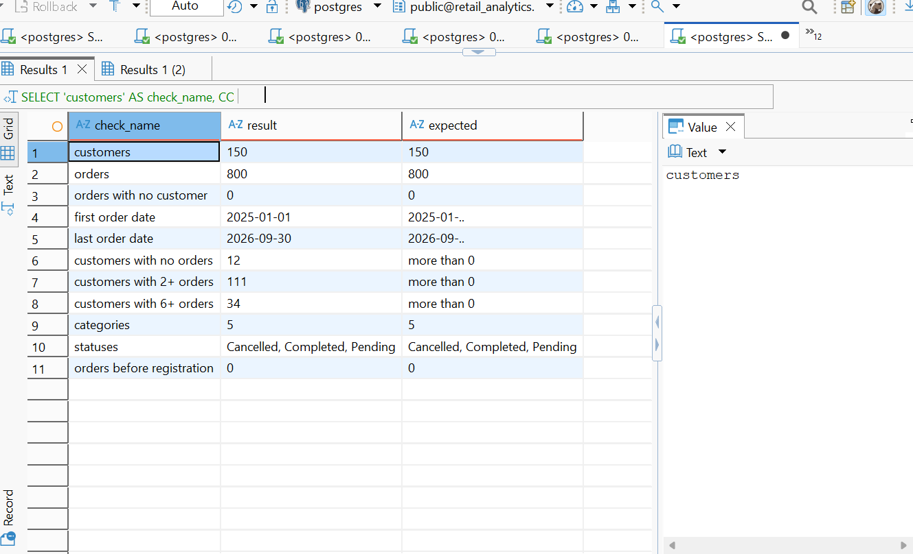

# Retail Sales & Customer Intelligence Using PostgreSQL

Week 10 project, Cohort 9 (Data Science)

## About the project

Duka Smart Electronics is a Kenyan retailer selling phones, laptops, accessories, TVs and home appliances in ten towns: Nairobi, Mombasa, Kisumu, Nakuru, Eldoret, Thika, Nyeri, Meru, Machakos and Kiambu. It has traded since January 2025 and stores every order in a database, but nobody had analysed it.

In this project I played the role of a junior data analyst. I set up a PostgreSQL database, loaded 150 customers and 800 orders, answered 46 business questions in SQL, and wrote up what management should do. Management wanted to know:

- Who are our best customers?
- Which products actually make money?
- Are sales growing?
- Which customers have stopped buying?

## Tools used

- PostgreSQL
- DBeaver (SQL editor)
- GitHub

SQL skills covered: `SELECT`, `WHERE`, `GROUP BY`, `HAVING`, `JOIN` and `LEFT JOIN`, subqueries, CTEs, window functions (`RANK`, `ROW_NUMBER`, `DENSE_RANK`, `LAG`, `NTILE`), a view, and a PL/pgSQL function.

## Repository contents

| File | Description |
|---|---|
| `schema.sql` | `CREATE TABLE` statements for `customers` and `orders`, with primary keys, a foreign key and CHECK constraints |
| `queries.sql` | All 46 answers, each under a `-- Q1` ... `-- Q46` comment |
| `insights.md` | Business insights, each with the evidence, why it matters and a recommendation |
| `screenshots/` | Data check output and key query results |

## Database design

Two tables linked by `customer_id` (one customer can have many orders).

**customers** (150 rows)

| Column | Type | Notes |
|---|---|---|
| customer_id | INTEGER | Primary key |
| customer_name | VARCHAR(100) | Not null |
| gender | VARCHAR(10) | Male / Female |
| city | VARCHAR(50) | One of ten towns |
| registration_date | DATE | |
| customer_segment | VARCHAR(20) | Retail, Corporate or VIP |

**orders** (800 rows)

| Column | Type | Notes |
|---|---|---|
| order_id | INTEGER | Primary key |
| customer_id | INTEGER | Foreign key to customers |
| order_date | DATE | January 2025 to September 2026 |
| product_name | VARCHAR(100) | |
| product_category | VARCHAR(50) | Electronics, Accessories, Home Appliances, Computing, Mobile Phones |
| quantity | INTEGER | Must be above 0 |
| unit_price | NUMERIC(12,2) | KSh, before discount |
| cost_price | NUMERIC(12,2) | KSh per unit |
| discount | NUMERIC(5,2) | Percentage, 0 to 100 |
| payment_method | VARCHAR(30) | M-Pesa, Cash, Card, Bank Transfer |
| order_status | VARCHAR(20) | Completed, Pending, Cancelled |

## How to set it up

1. Install PostgreSQL and a SQL editor such as DBeaver or pgAdmin.
2. Connected to the default `postgres` database, create the database:
   ```sql
   CREATE DATABASE retail_analytics;
   ```
3. Connect to `retail_analytics`. A connection is tied to one database in PostgreSQL, so check that the editor shows `public@retail_analytics` before running anything else.
4. Run `schema.sql` to create the tables.
5. Load the data using the course files, in this order (customers first, because orders refer to them):
   - `03_insert_customers.sql`
   - `04_insert_orders.sql`
6. Run `05_verify_data.sql`. It should show **150 customers** and **800 orders**, with 0 orders missing a customer.

The data files are from the course project and are not included in this repo.

## How to run the queries

Open `queries.sql` in an editor connected to `retail_analytics` and run one query at a time (Ctrl+Enter in DBeaver). Two things to keep in mind:

- Q43 creates the view `monthly_sales_summary` and Q44 creates the function `customer_revenue`. Run these before the queries that depend on them (Q46d uses the view).
- When running Q44, select the whole function block first so the editor does not cut it at the first semicolon.

## Business rules

| Measure | Formula |
|---|---|
| Revenue | `quantity * unit_price * (1 - discount / 100)` |
| Cost | `quantity * cost_price` |
| Profit | revenue - cost |
| Profit margin % | profit / revenue * 100 (using `NULLIF` to avoid dividing by zero) |

- Money questions count **Completed** orders only. Order counts include every status.
- "Today" is the latest `order_date` in the data (30 September 2026), not the computer's date.
- A month means a year and a month, so January 2025 and January 2026 are different months.

## Choices I made

- Q18 (units sold) counts Completed orders only, since cancelled and pending orders were not actually sold.
- Q27, Q41 and Q45 include only customers with at least one completed order.
- Q28 measures "popular" by the number of orders placed.
- Q45 thresholds: High = KSh 250,000 or more, Medium = 50,000 to 249,999, Low = under 50,000. The reasoning is in the query comments.

## Key results

| Measure | Result |
|---|---|
| Completed revenue | KSh 24,155,371.70 |
| Completed profit | KSh 2,890,921.70 (about 12% margin) |
| Cancelled orders | 11.25% |
| Customers who never ordered | 12 |
| Top category by revenue | Mobile Phones (28.74% of revenue) |
| Most profitable category | Mobile Phones (KSh 728,760.65), but Accessories have the best margin (42.39%) |
| Best month | August 2026 (KSh 2,242,033.90) |
| Lowest month | January 2026 (KSh 322,432.95) |

The full findings, with recommendations, are in [insights.md](insights.md).

## Screenshots

The `screenshots/` folder has the output of the data check (150 customers, 800 orders) and a few key results.


